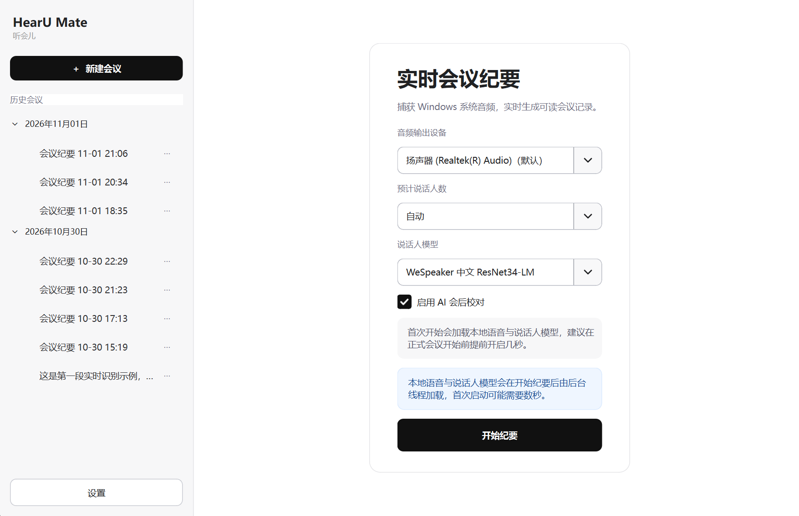
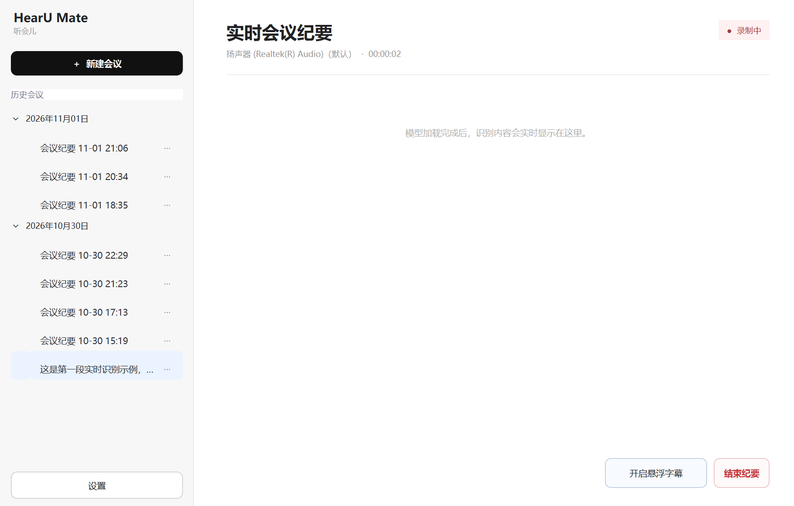
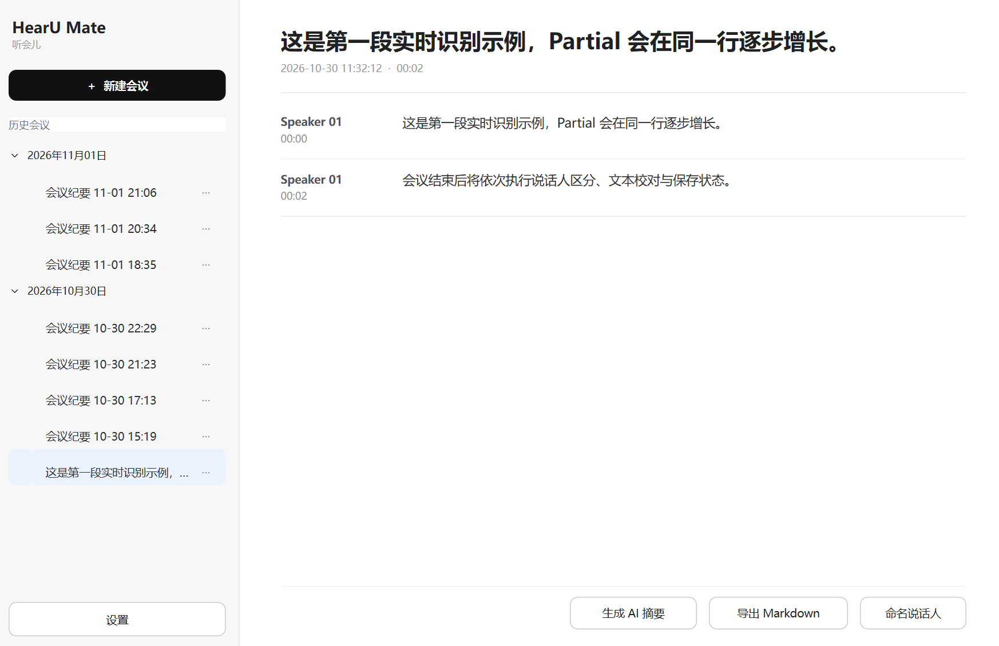

# HearU Mate（听会儿）

<p align="center">
  
</p>

<p align="center">
  本地优先的 Windows 实时转写助手，适用于会议、课程以及本地播放的音视频。
</p>

<p align="center">
  Local-first Windows transcription for meetings, lectures, and locally played media.
</p>

> 当前仓库提供源码开发版本，暂不发布预编译安装包。Windows 安装包计划在
> 功能进一步稳定后的 `0.2.0` 或 `1.0.0` 版本发布。

## 界面预览

<!-- 截图位置 1：将主界面截图保存为 docs/images/home.png 后取消下一行注释。 -->
<!--  -->

<!-- 截图位置 2：将实时转写截图保存为 docs/images/live-transcription.png。 -->
<!--  -->

<!-- 截图位置 3：将历史纪要截图保存为 docs/images/history-summary.png。 -->
<!--  -->

## 功能

- Windows WASAPI Loopback 系统音频采集，不需要虚拟声卡或本地 HTTP 服务。
- Paraformer Streaming 中英双语实时识别，支持 Partial/Final 流式显示。
- 可拖动、始终置顶的实时悬浮字幕。
- 会后说话人区分、时间对齐和说话人自定义命名。
- OpenAI-compatible 会后文本校对和结构化会议摘要。
- 可接入 DeepSeek、硅基流动及其他兼容 Chat Completions 的服务。
- 原始文本与 AI 校对文本分离保存；API 失败时保留原始转写。
- SQLite 历史记录，以及 JSON、Markdown 导出。
- 会议重命名、二次确认删除和 Markdown 导出。
- 长会议音频写入临时文件，Final 片段实时检查点保存，降低异常退出损失。

## 本地模型

HearU Mate 使用三类本地语音能力。其中“说话人区分”由分段模型和声纹模型
共同完成。

| 能力 | 模型 | 来源 | 许可证 |
| --- | --- | --- | --- |
| 语音活动检测 | Silero VAD ONNX | [Silero VAD](https://github.com/snakers4/silero-vad)、[sherpa-onnx 模型发布](https://github.com/k2-fsa/sherpa-onnx/releases/tag/asr-models) | MIT |
| 中英双语 ASR | Streaming Paraformer INT8 ONNX | [ModelScope Paraformer](https://modelscope.cn/models/iic/speech_paraformer-large_asr_nat-zh-cn-16k-common-vocab8404-online)、[sherpa-onnx 模型发布](https://github.com/k2-fsa/sherpa-onnx/releases/tag/asr-models) | Apache-2.0 |
| 说话人分段 | pyannote segmentation 3.0 INT8 ONNX | [pyannote/segmentation-3.0](https://huggingface.co/pyannote/segmentation-3.0)、[sherpa-onnx 模型发布](https://github.com/k2-fsa/sherpa-onnx/releases/tag/speaker-segmentation-models) | MIT |
| 说话人声纹 | WeSpeaker CN-Celeb ResNet34-LM ONNX | [Wespeaker/wespeaker-cnceleb-resnet34-LM](https://huggingface.co/Wespeaker/wespeaker-cnceleb-resnet34-LM) | Apache-2.0 |

仓库不包含、也不会自动下载模型。开发版默认从以下目录读取：

```text
D:\models\sherpa-onnx\
├── silero-vad\
│   └── silero_vad.onnx
├── paraformer-streaming-int8\
│   ├── encoder.int8.onnx
│   ├── decoder.int8.onnx
│   └── tokens.txt
└── speaker-diarization\
    ├── pyannote-segmentation\
    │   └── model.int8.onnx
    └── wespeaker-cnceleb-resnet34-LM-sherpa.onnx
```

WeSpeaker 文件保持原始权重，仅补充 sherpa-onnx 读取所需的模型元数据。
模型的许可证、来源和修改说明见
[THIRD_PARTY_NOTICES.md](THIRD_PARTY_NOTICES.md)。

## 源码运行

### 环境要求

- Windows 10/11 x64
- Python 3.11
- Conda（推荐）
- 支持 WASAPI Loopback 的 Windows 输出设备

创建环境并安装依赖：

```powershell
conda create -n hearu-mate python=3.11
conda activate hearu-mate
python -m pip install -r requirements.txt
```

按上面的目录准备模型后，在项目根目录启动：

```powershell
python -m desktop.app
```

模型采用延迟初始化。查看历史记录和修改设置不会加载语音模型；只有开始转写
后才会加载模型并打开音频设备。

## AI 校对与摘要

AI 功能是可选的，本地转写不依赖在线 API。首次启用 AI 功能时，在设置页填写：

- API 地址
- 完整模型名称
- 用户自己的 API Key

DeepSeek 示例：

```text
API 地址：https://api.deepseek.com
模型名称：使用账户中可用的模型名称
```

硅基流动示例：

```text
API 地址：https://api.siliconflow.cn/v1
模型名称：从硅基流动模型广场复制完整 Model ID
```

不要把 API Key 写入源码、Issue、截图或提交记录。

## 数据与隐私

- VAD、ASR 和说话人分析均在用户电脑本地运行。
- 默认不保存原始音频。
- 录制期间的分析音频存放在系统临时文件中，结束或失败后释放。
- Final 片段实时写入 SQLite，异常退出时已完成的片段仍可恢复查看。
- 只有启用 AI 校对或 AI 摘要时，会议文字才会发送给用户配置的 API 服务；
  原始音频不会发送给该服务。
- API Key 保存在本地 `.env`，并被 `.gitignore` 排除。
- `.env`、会议数据、数据库、音视频、模型和构建产物不会被提交到 Git。

请在录制或转写他人内容前遵守所在地法律、平台规则，并取得必要同意。

## 开发与测试

桌面 GUI 使用 PySide6。GUI 主线程只负责界面；设备枚举、录音、VAD、ASR、
说话人区分、AI 校对和摘要均在工作线程或隔离进程中运行。

运行不访问真实声卡和模型的单元测试：

```powershell
python -m unittest discover -s tests -v
```

分支约定：

- `main`：源码开发分支，使用开发模型目录和项目内会议数据。
- `packaging/windows-installer`：Windows 安装版构建分支，使用安装目录模型和
  `%LOCALAPPDATA%\HearU Mate` 用户数据目录。

## 已知限制

- 当前只支持 Windows。
- 当前主要采集系统输出音频，不是麦克风录音工具。
- 说话人身份在会后分析，实时阶段显示的是转写内容而非最终说话人标签。
- 英文专有名词、人名、低音质音频和多人重叠说话仍可能影响准确率。
- 尚未提供自动更新和公开预编译安装包。

## 项目结构

```text
MeetingRecorderDesktop/
├── meeting/       # 音频、VAD、ASR、说话人、校对和存储核心
├── desktop/       # PySide6 GUI 与工作线程
├── assets/        # 图标与界面资源
├── config/        # 开发配置示例
├── data/meetings/ # 本地会议数据（Git 忽略）
├── tests/         # 不加载真实模型的单元测试
└── packaging/     # Windows 安装版构建文件（安装分支）
```

## 许可证

项目源码采用 [Apache License 2.0](LICENSE)。第三方库和模型继续受各自许可证
约束，详见 [THIRD_PARTY_NOTICES.md](THIRD_PARTY_NOTICES.md)。

Apache-2.0 允许个人和企业使用、修改、分发及商业化本项目，但必须遵守许可证
中的版权、许可声明和修改说明要求。
